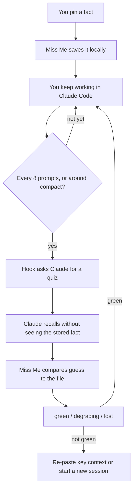

# Miss Me

Know when your AI actually forgets.

In a long Claude Code session the model can drop a constraint, a stack choice, or a name you set early on, and still sound just as sure. Miss Me is a local MCP server and a set of Claude Code hooks. You pin a few facts. The session is quizzed on a schedule and around context compact. You get a health signal: green, degrading, or lost.

No account. No API key. No Miss Me backend. Pinned facts stay in `.miss-me/state.json` in the project.

This is not a browser extension and not an offline eval harness.

## How it works

You pin a fact. Miss Me stores it on disk. Claude does not get that text back as a reminder. Later, a hook forces a quiz: Claude must say what it thinks each pin was. Miss Me scores the guess and reports health.



The hook is the timer. The MCP tool is the quiz. If Check were only a tool, a model that had already forgotten would also forget to call it.

## Health

| Result | Health |
| --- | --- |
| Every pinned fact recalled | green |
| Some recalled | degrading |
| None recalled | lost |
| Nothing pinned, or the check is unusable | unknown (no alarm) |

If health is not green, treat the thread as unreliable for those facts.

## Install

Requires Node.js 20 or later and Claude Code.

```bash
git clone <your-repo-url>
cd miss_me
npm install
npm run build
node dist/index.js init
```

Restart Claude Code after `init`. That command:

1. Registers the `miss-me` stdio MCP server for your user account.
2. Adds hooks on `UserPromptSubmit`, `SessionStart` (compact and resume), and `PreCompact`.
3. Appends `.miss-me/` to the current project's `.gitignore`.

`init` writes into `~/.claude.json` and `~/.claude/settings.json`. It merges if those files already exist. It will not overwrite a file that is not valid JSON.

## Use

In Claude Code, ask it to pin what must not be lost: a stack, an audience, a hard constraint. That calls `miss_me_pin`.

Keep working. Every eight user prompts, and when the session is about to compact or has just resumed, the hook asks Claude to call `miss_me_check` with its recollection. The stored facts are never injected into context.

Show the last result:

```bash
node dist/index.js status
```

From the terminal you can also pin without the model:

```bash
node dist/index.js pin "The API is FastAPI with Postgres"
node dist/index.js unpin a1
```

Optional short labels (for example `stack`) are handles only. They must not be the fact itself, or the quiz becomes open-book.

## Tools

| Tool | Purpose |
| --- | --- |
| `miss_me_pin` | Store an anchor fact locally |
| `miss_me_list` | Ids and labels only, not the facts |
| `miss_me_unpin` | Remove an anchor by id |
| `miss_me_check` | Score Claude's recollection |
| `miss_me_status` | Last health for this project |

## Trust

- The process speaks stdio only. Miss Me does not open a network socket.
- Hooks print no logs. The MCP server writes one line to stderr when it starts.
- Quiz reminders list ids and labels, never the stored facts.
- Do not pin secrets. The file is plain JSON on disk.

## Other clients

The same `miss-me mcp` process is a normal stdio MCP server. Cursor, Claude Desktop, or Gemini CLI can point at it:

```json
{
  "mcpServers": {
    "miss-me": {
      "type": "stdio",
      "command": "node",
      "args": ["/absolute/path/to/miss_me/dist/index.js", "mcp"]
    }
  }
}
```

Hooks in this version are Claude Code only. Without hooks, a check runs only if the model chooses to call the tool.

## Development

```bash
npm install
npm test
npm run build
```

## License

MIT
